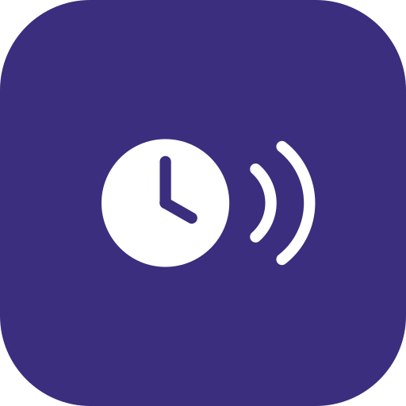
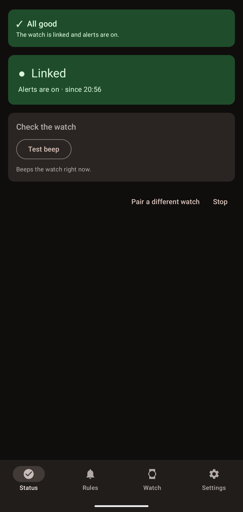
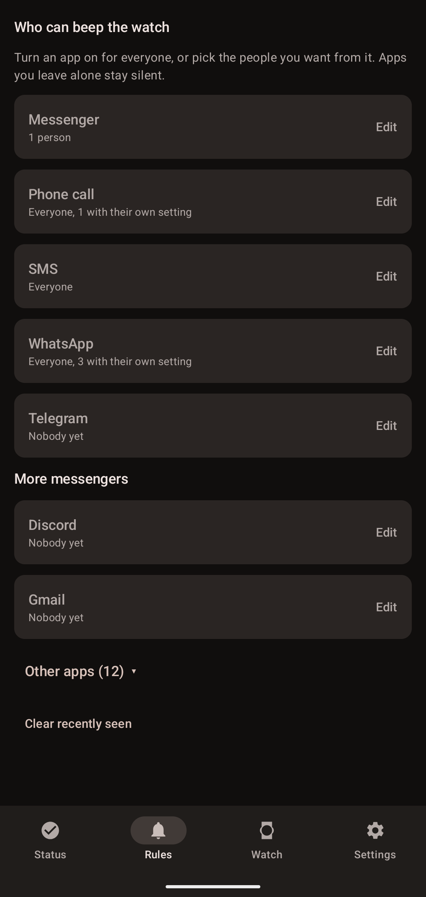
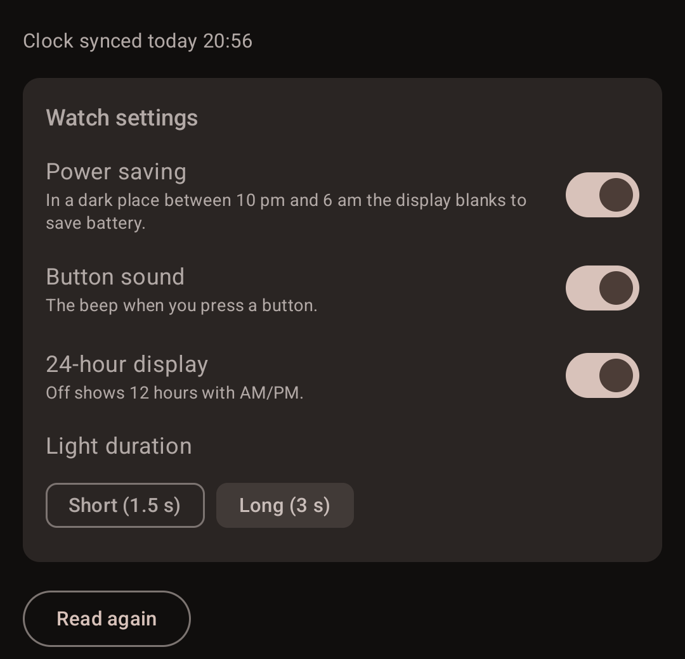
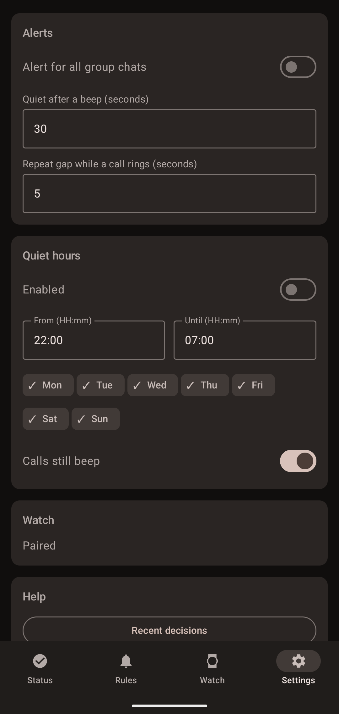

<p align="center">
  
</p>

<h1 align="center">Casio Pager</h1>

<p align="center">Make your Casio ABL-100WE beep for the messages and calls you care about.</p>

[](https://github.com/pkonowrocki/casio-pager/actions/workflows/ci.yml)
[](LICENSE)

An Android app that makes a Casio ABL-100WE (module 3565) beep when a message or call you care about arrives.
The watch has no notification feature of its own, so the app holds a Bluetooth link to it and triggers its alert.

> **Unofficial.** Casio Pager is not affiliated with, endorsed by or sponsored by Casio. It contains no Casio code or
> firmware. The Bluetooth behaviour was worked out by observing the watch for interoperability, see
> [docs/PROTOCOL.md](docs/PROTOCOL.md). "Casio" is a trademark of its owner.

## The catch, up front

The watch only accepts a Bluetooth link when it starts one itself. Only a **long-press of its connect button** gives a
link that stays up (for hours). The watch's own automatic sessions (00:30, 06:30, 12:30, 18:30) last a few seconds, and
the phone cannot wake the watch. So alerts reach the watch **only while you have long-pressed it** and the link is still
held. The app makes this visible: the Status screen and a Quick Settings tile show whether the link is up.

## Features

- **Rules per app**: off, everyone, or only the people you pick. Rules for WhatsApp, Messenger, SMS, phone calls and
  Telegram, plus more messengers (Signal, Viber, Discord, Slack, Teams, Gmail, Outlook, ...) and any other app that posts
  notifications.
- **Group chats**: allow all of them, or just the chats you choose (matched by chat title).
- **Quiet hours** per weekday, with an option for calls to still get through, and a quiet period after a beep so a burst
  of messages sounds once.
- **Calls** repeat the beep while the phone rings.
- **"Is it working?" card** and a **Quick Settings tile** showing the link state, plus **Recent decisions** that
  explain why a message did or did not beep (no names or text).
- **Watch settings** from the phone: 24 h, button sound, light duration, power saving, connection time, timer.
- **Steps**: reads the watch's Life Log on every link and every 20 minutes while linked, and keeps a daily history.
- **The clock** is written to the watch on every link, so it stays right.
- English, Deutsch, Français, Español and Polski.

## Supported watch

Developed and tested with a **Casio ABL-100WE (module 3565)**. Other colour variants of the same watch should behave
the same, but that is untested. Other Casio or G-Shock models are untested and will probably not work.

## Install

Download the signed APK from the [Releases](https://github.com/pkonowrocki/casio-pager/releases) page and follow
[docs/INSTALL.md](docs/INSTALL.md). In short: install, grant the permissions the first-run screen asks for, allow
notification access, pair the watch by long-pressing its connect button, and uninstall (or disable) Casio's own app,
because only one app can hold the watch. Requires Android 13 or newer.

## Privacy

Everything runs on your phone. Message text and contact names are never stored in logs or sent anywhere, and the app
makes no network requests unless you opt in to sending diagnostics to a server of your own. See [PRIVACY.md](PRIVACY.md).

## Build from source

```
cd android
./gradlew testDebugUnitTest lintDebug assembleDebug
```

Needs JDK 17 and the Android SDK (platform 36, build-tools 35). Details, release process and signing are in
[android/README.md](android/README.md). Contributions are welcome: see [CONTRIBUTING.md](CONTRIBUTING.md).

## Screenshots

<p align="center">
  
  
  
  
</p>

Status, Rules, Watch and Settings.

## Licence

[MIT](LICENSE). No code was copied from other projects; open-source G-Shock projects (gshockapi, Gadgetbridge) were
read as references for how the watch behaves.
